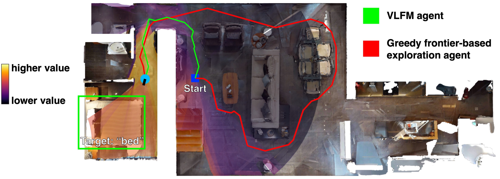
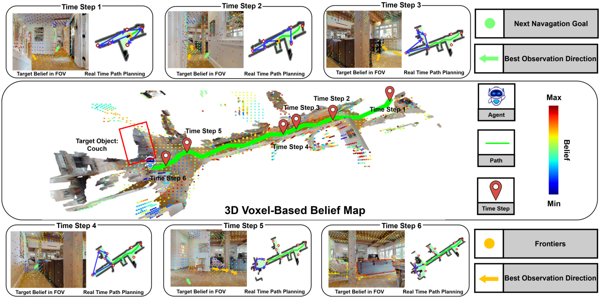
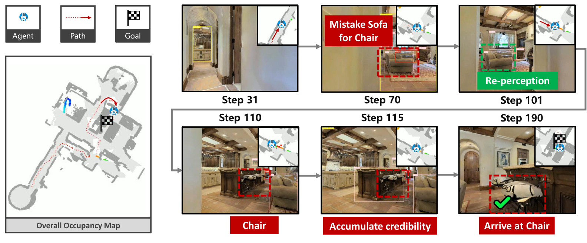
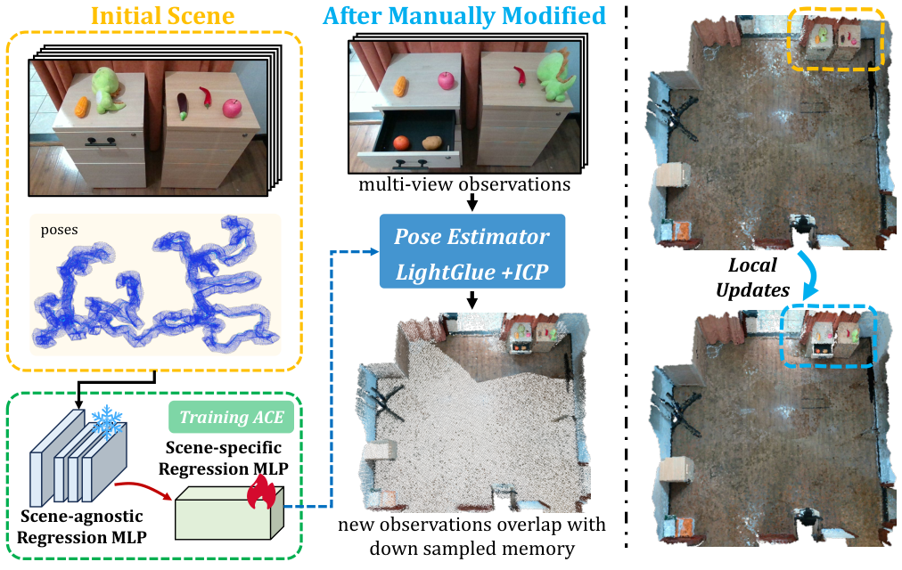
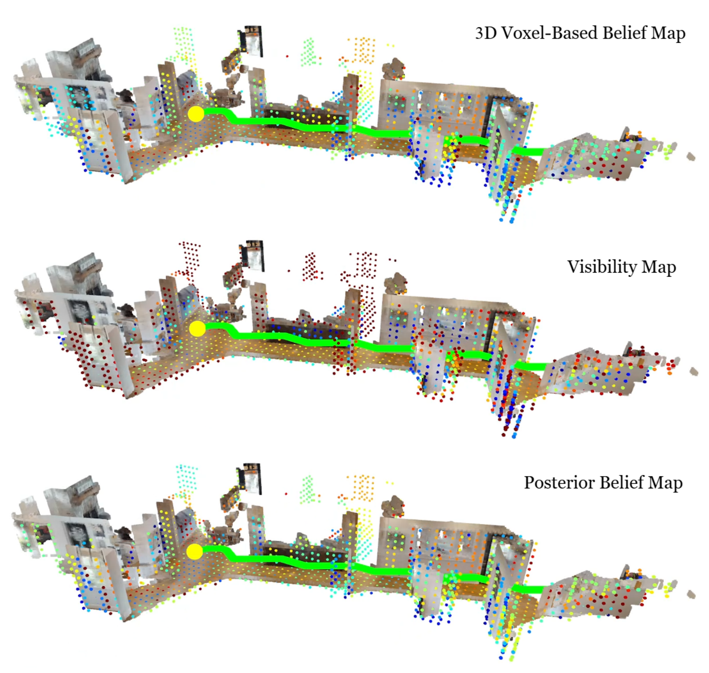
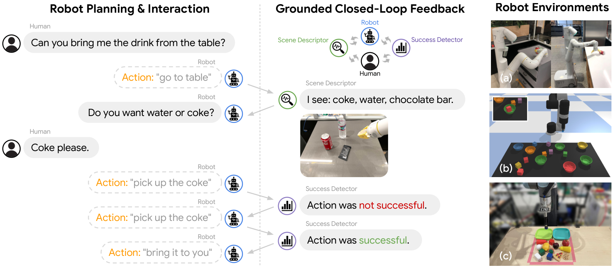

# Fig. 8 配图参考调研（2026-10-24）

本轮是原图调研与选择，不是新一版 Fig. 8。未修改论文和此前绘图文件。

先看 `Fig8_reference_overview.png`；`Fig8_reference_selection.pdf` 包含总览和六张带说明的大图。
各原始图的独立 PNG / PDF 在 `figures/`，下载的论文在 `papers/`。

检视了 VLFM、BeliefMapNav、SG-Nav、DovSG、Inner Monologue 和 SayPlan 的实际配图。
SayPlan Fig. 1 适合理解系统流程，但模块与文字较多；Inner Monologue Fig. 5 同样偏文字，未列入候选。

优先比较 01 和 02 的整体构图；03 和 04 用于判断是否能直观解释恢复与地图更新。05、06 是局部表达补充。
这是一组视觉参考，不主张照搬任一论文的方法、数值或完整布局。

## 01 — 真实场景 + 半透明信息层

**VLFM，Fig. 1，PDF 第 1 页。** [论文原文](https://arxiv.org/pdf/2312.03275v1#page=1)

可借鉴：空间位置、搜索路径和数值层共用一张底图，读者无需另猜抽象符号。

与你的图：适合 Fig. 8 的主场景，以及“去哪里继续找”的空间关系。

差异与取舍：原图表达目标搜索的语义价值与路径比较，不直接表示覆盖驱动的负证据更新。

## 02 — 一张主地图串起多个观测时刻

**BeliefMapNav，Fig. 1，PDF 第 2 页。** [论文原文](https://arxiv.org/pdf/2506.06487v1#page=2)

可借鉴：中间地图承担空间主线，上下观测对应地图上的时间节点，有明确主次。

与你的图：适合把局部重试、切换搜索区域和最终验证放在同一段执行过程里。

差异与取舍：原图的六个时间点、彩色体素和路径细节较多；小尺寸 Fig. 8 应只保留关键转折。

## 03 — 误检 → 再观察 → 确认目标

**SG-Nav，Fig. 6, lower example，PDF 第 9 页。** [论文原文](https://arxiv.org/pdf/2410.08189v1#page=9)

可借鉴：连续相机观测和固定的局部地图，直接解释为何重新判断目标。

与你的图：适合解决“失败以后具体看到了什么、为什么继续找”的直观表达。

差异与取舍：这是原图下半部的单个例子。它纠正目标误检，与本论文的未检出恢复并非同一机制；借鉴因果呈现。

## 04 — 新观测对应地图的局部更新

**DovSG，Fig. 3，PDF 第 5 页。** [论文原文](https://arxiv.org/pdf/2410.11989v6#page=5)

可借鉴：用真实局部观测与更新前后地图的对应区域，交代“哪里发生了变化”。

与你的图：适合 Fig. 8 的地图更新部分；可把观测、确认实例及对应图节点建立明确关联。

差异与取舍：原图含重定位和配准流程，不能照搬为本论文的融合模块；本论文还需保留执行后插入实例的时间关系。

## 05 — 同一视角下比较三层空间证据

**BeliefMapNav，Fig. 12，PDF 第 20 页。** [论文原文](https://arxiv.org/pdf/2506.06487v1#page=20)

可借鉴：三个视角完全一致的场景上下排列，便于对照先验、可见性与后验。

与你的图：适合参考“置信度变化仍然附着在具体空间上”的表达，避免孤立的小网格。

差异与取舍：原文是体素信念与可见性，本论文是区域信念与新增覆盖；不把三张全图直接塞入小尺寸 Fig. 8。

## 06 — 动作与反馈一一对应

**Inner Monologue，Fig. 1，PDF 第 2 页。** [论文原文](https://proceedings.mlr.press/v205/huang23c/huang23c.pdf#page=2)

可借鉴：动作旁边就是成功或失败反馈，重试发生的原因沿阅读顺序展开。

与你的图：适合借鉴少量反馈文字的摆放与连接方式，是主场景以外的补充参考。

差异与取舍：空间信息较弱，若以对话气泡为主体仍会偏文字化；仅取反馈对应关系。

## 对此前 Fig. 8 的判断

B、C 中的孤立网格、方块和缩小的三维视图未能对应同一具体场景，读者需要先解码符号，才能理解恢复过程。
参考中的透明层有效，是因为它们承载数值或空间范围，而且能与底图中的实际位置对齐；透明材质本身不能解决叙事问题。
下一轮应在选定整体构图后，围绕同一例子组织“未检出—局部重试—跨区域恢复—确认—执行后更新”。
原文必须保留的区别：重复覆盖不重复增加负证据；锚点物体仍然有效；目标成功验证发生在执行中，确认新实例插图发生在执行后。

来源与裁剪坐标、页码、PDF SHA-256 见 `sources.json`。所有原图版权归各论文作者。
